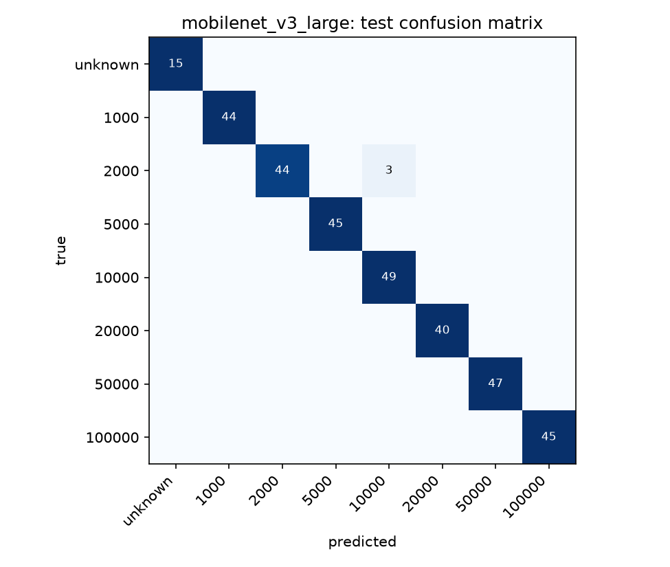

# RupiahVision

Hands-free Indonesian Rupiah banknote recognition for blind and low-vision users. Point a phone
camera at a note and the app speaks its denomination in Indonesian. If it isn't confident, it
stays silent or says "Tidak dikenali" (not recognized), never a guess. The app runs fully in the
browser as an installable web app (PWA), so trying it needs only a link.

> **Status:** v1 ([PLAN.md](PLAN.md)). The model is trained on public datasets and runs in the
> browser. It has not yet been tested by blind or low-vision users.

## How the app works

1. **Tap anywhere to start.** iOS only allows speech and sound after a tap, so this one tap is
   needed. After it, the app is hands-free.
2. The back camera runs continuously. About 6 times a second, the app takes the centre square of
   the frame and runs the model on the phone itself, with
   [ONNX Runtime Web](https://onnxruntime.ai/docs/tutorials/web/) (WebAssembly). No image leaves
   the phone, and after the first visit it works offline.
3. **Aiming:** soft ticks speed up as the model becomes more sure it sees a note. Android phones
   also vibrate; iOS Safari has no vibration API.
4. **Speaking:** a denomination is announced only when 3 of the last 5 frames are confident
   about the same one (calibrated probability at or above the threshold below). It's said once
   in Indonesian (*"Lima puluh ribu rupiah"*), after a short rising tone. It's said again only
   when a different note appears, or when the same note returns after leaving the frame. Tap
   anywhere to repeat it.
5. If the picture is too dark to use, it says *"Terlalu gelap"* (too dark), at most every 6
   seconds. With no confident note, it says nothing.

Options: English speech, aiming sounds on/off, and **screen reader mode**. In that mode,
announcements go to VoiceOver or TalkBack through a live region instead of the speech engine,
so the two never talk over each other.

## What it recognizes

All seven denominations, in both the 2016 (TE2016) and 2022 (TE2022) series. The v1 model
predicts the denomination directly, plus `unknown` (8 outputs), because the public datasets
don't label series or side. v2, trained on our own photos, will use 28 classes
(denomination × series × side) plus `unknown`. Either way the app announces only the
denomination. This table is generated from [`data/labels.json`](data/labels.json):

<!-- BEGIN GENERATED: classes -->
| Denomination | Series | Spoken (id-ID) | Spoken (en-US) |
|---|---|---|---|
| Rp1.000 | TE2016, TE2022 | Seribu rupiah | One thousand rupiah |
| Rp2.000 | TE2016, TE2022 | Dua ribu rupiah | Two thousand rupiah |
| Rp5.000 | TE2016, TE2022 | Lima ribu rupiah | Five thousand rupiah |
| Rp10.000 | TE2016, TE2022 | Sepuluh ribu rupiah | Ten thousand rupiah |
| Rp20.000 | TE2016, TE2022 | Dua puluh ribu rupiah | Twenty thousand rupiah |
| Rp50.000 | TE2016, TE2022 | Lima puluh ribu rupiah | Fifty thousand rupiah |
| Rp100.000 | TE2016, TE2022 | Seratus ribu rupiah | One hundred thousand rupiah |
| (no note / not confident) | - | Tidak dikenali | Not recognized |
<!-- END GENERATED: classes -->

## Training data (v1): public datasets

Two public datasets, audited in [data/SOURCES.md](data/SOURCES.md):

- Kaggle [rupiah banknotes 2022](https://www.kaggle.com/datasets/fzmhww8782/rupiah-22) by
  fzmhww8782: photos in one folder per denomination, plus background photos used as `unknown`.
  The license is unknown, so its images are only used for training here and are never
  redistributed.
- Roboflow [Uang Rupiah Emisi 2022](https://universe.roboflow.com/bangkit-poc9z/uang-rupiah-emisi-2022-bw0in)
  by bangkit, [CC BY 4.0](https://creativecommons.org/licenses/by/4.0/): each labelled box is
  cropped into one image, plus one crop per photo away from every box, used as `unknown`.

Images are split by **photo group**, not one by one. Consecutive camera shots, and all of
Roboflow's augmented copies of one photo, stay in the same split. Any val or test image that
nearly duplicates an image in another split (by dHash) is dropped.

<!-- BEGIN GENERATED: public_dataset -->
| Label | Train | Val | Test |
|---|---|---|---|
| unknown | 78 | 18 | 15 |
| 1000 | 163 | 61 | 44 |
| 2000 | 127 | 67 | 47 |
| 5000 | 207 | 51 | 45 |
| 10000 | 242 | 55 | 49 |
| 20000 | 184 | 43 | 40 |
| 50000 | 227 | 50 | 47 |
| 100000 | 200 | 41 | 45 |
| **total** | 1428 | 386 | 332 |
| photo groups | 145 | 35 | 45 |

Near-duplicate check:
- dropped 8 test image(s) near-duplicating train
- dropped 19 val image(s) near-duplicating train
<!-- END GENERATED: public_dataset -->

## Own photos (v2)

Photos of real notes, taken following the [capture protocol](docs/data-collection.md). Splits
are made per physical note and per capture session, never per random image, so the test set
shows notes, places and lighting the model never trained on. Public-dataset images are used
for training only, because there's no way to tell which physical note each one shows.

**Test separation**, measured from the images rather than the plan:

- **note-disjoint**: every test note is a physical note that never appears in train or val.
- **test note-disjoint, val by session**: the same, except val reuses the training note in
  other sessions (classes with only two notes).
- **session only**: the class has one note, so train, val and test differ only by session.
  Accuracy for these classes is likely optimistic.

<!-- BEGIN GENERATED: dataset -->
| Denomination | Series | Notes | Test separation | Train | Val | Test | Public (train only) |
|---|---|---|---|---|---|---|---|
| Rp1.000 | TE2016 | 0 | no notes yet | 0 | 0 | 0 | 0 |
| Rp1.000 | TE2022 | 0 | no notes yet | 0 | 0 | 0 | 0 |
| Rp2.000 | TE2016 | 0 | no notes yet | 0 | 0 | 0 | 0 |
| Rp2.000 | TE2022 | 0 | no notes yet | 0 | 0 | 0 | 0 |
| Rp5.000 | TE2016 | 0 | no notes yet | 0 | 0 | 0 | 0 |
| Rp5.000 | TE2022 | 0 | no notes yet | 0 | 0 | 0 | 0 |
| Rp10.000 | TE2016 | 0 | no notes yet | 0 | 0 | 0 | 0 |
| Rp10.000 | TE2022 | 0 | no notes yet | 0 | 0 | 0 | 0 |
| Rp20.000 | TE2016 | 0 | no notes yet | 0 | 0 | 0 | 0 |
| Rp20.000 | TE2022 | 0 | no notes yet | 0 | 0 | 0 | 0 |
| Rp50.000 | TE2016 | 0 | no notes yet | 0 | 0 | 0 | 0 |
| Rp50.000 | TE2022 | 0 | no notes yet | 0 | 0 | 0 | 0 |
| Rp100.000 | TE2016 | 0 | no notes yet | 0 | 0 | 0 | 0 |
| Rp100.000 | TE2022 | 0 | no notes yet | 0 | 0 | 0 | 0 |
| unknown (no note) | - | 0 objects | - | 0 | 0 | 0 | - |

Total: 0 train / 0 val / 0 test images from 0 / 0 / 0 capture sessions.
<!-- END GENERATED: dataset -->

## Results (v1)

> **Read this first.** The test images come from the same two public datasets as the training
> images, and very likely show the same physical notes in similar settings. Splitting by photo
> group removes near-copies but not that overlap. **These numbers are optimistic:** expect
> lower accuracy on a new note, phone and room. The v2 test set (own photos, held-out notes
> and places) fixes this.

Every number below is generated from a JSON file in [`results/`](results/) by a script in
this repo (see [Reproducing](#reproducing)). The 95% confidence intervals treat each photo
group, not each image, as one observation, because shots in a group are near-copies. Each is the
wider of a group bootstrap and a Wilson interval over groups. That's why a class that is 100%
correct on 5 groups still shows a lower bound near 57%: 5 sessions can't prove much more.

How the app decides to speak: it announces a denomination only if the model's calibrated
probability is at least the **threshold**. The threshold is the lowest value at which at most
1% of announcements were wrong on the validation set. **Coverage** is the share of test
banknote images the app announces. **Risk** is the share of announcements that were wrong.
**Said on no-note** is the share of `unknown` test images where it announced a denomination.

<!-- BEGIN GENERATED: models -->
| Model | Params | ONNX | Val acc | Test acc (95% CI) | Macro acc (95% CI) | Threshold | Coverage | Risk (wrong/said) | Said on no-note | CPU ms median (p95) |
|---|---|---|---|---|---|---|---|---|---|---|
| `custom_cnn` | 0.98 M | 4.0 MB | 89.6% | 88.6% (76.1%–97.9%) | 88.7% (76.3%–97.0%) | 0.87 | 63.7% | 2.0% (4/202) | 0.0% (0/15) | 6.4 (6.8) |
| `mobilenet_v3_small` | 1.53 M | 6.4 MB | 96.1% | 97.6% (88.1%–100.0%) | 97.9% (88.7%–100.0%) | 0.83 | 95.6% | 1.0% (3/303) | 0.0% (0/15) | 2.2 (2.5) |
| `mobilenet_v3_large` | 4.21 M | 17.2 MB | 97.9% | 99.1% (90.5%–100.0%) | 99.2% (90.7%–100.0%) | 0.49 | 99.7% | 0.9% (3/316) | 0.0% (0/15) | 5.4 (6.0) |

CPU latency: ONNX Runtime from Python on Apple M1 Pro, one image.
<!-- END GENERATED: models -->

<!-- BEGIN GENERATED: per_class -->
Selected model (best validation accuracy): `mobilenet_v3_large`.

| Label | Test images | Photo groups | Accuracy (95% CI) |
|---|---|---|---|
| unknown | 15 | 10 | 100.0% (72.2%–100.0%) |
| 1000 | 44 | 5 | 100.0% (56.6%–100.0%) |
| 2000 | 47 | 4 | 93.6% (44.9%–100.0%) |
| 5000 | 45 | 8 | 100.0% (67.6%–100.0%) |
| 10000 | 49 | 6 | 100.0% (61.0%–100.0%) |
| 20000 | 40 | 5 | 100.0% (56.6%–100.0%) |
| 50000 | 47 | 8 | 100.0% (67.6%–100.0%) |
| 100000 | 45 | 8 | 100.0% (67.6%–100.0%) |


<!-- END GENERATED: per_class -->

### In-browser latency

Measured by the app itself: open `/?bench`, run it, and save the JSON into
[`results/bench/`](results/bench/). This runs the same path as the app (crop, tensor, ONNX
Runtime Web, single-threaded WebAssembly) on a synthetic frame: 10 warm-up runs, then 50 timed.

<!-- BEGIN GENERATED: bench -->
| Device | Inference ms median (p95) | Preprocess ms median (p95) | Model load ms | Model, runtime |
|---|---|---|---|---|
| MacBook Pro M1 Pro, Chromium | 21.9 (22.4) | 1.3 (1.5) | 235 | `mobilenet_v3_large`, onnxruntime-web wasm |
| iPhone, Safari | not measured | not measured | not measured | - |
<!-- END GENERATED: bench -->

## Repository layout

```
ml/        Python package: data, training, evaluation, export (pytest tests in ml/tests)
web/       Vite + React + TypeScript PWA (vitest tests in web/src)
data/      Label schema and dataset manifests (images are not stored in git)
results/   Metrics and plots written by scripts; the README tables are generated from these
docs/      Architecture, data collection and user-testing protocols
```

## Setup

Requires [uv](https://docs.astral.sh/uv/) and Node.js 24+.

```bash
cd ml && uv sync          # Python 3.12 env with dev tools
uv run pytest             # ML tests
cd ../web && npm ci       # web dependencies
npm test                  # web tests
npm run dev               # local dev server
```

## Reproducing

All commands run from `ml/`.

**v1 model (public data).** Download the two datasets listed in
[data/SOURCES.md](data/SOURCES.md) (free accounts needed; Roboflow in COCO JSON format) into
`data/downloads/`, then:

```bash
uv run python -m rupiahvision.public import-kaggle ../data/downloads/<kaggle zip>
uv run python -m rupiahvision.public import-roboflow ../data/downloads/<roboflow zip>
uv run python -m rupiahvision.public split
uv run python -m rupiahvision.training.train --model custom_cnn --epochs 40 --lr 3e-3
uv run python -m rupiahvision.training.train --model mobilenet_v3_small --epochs 25
uv run python -m rupiahvision.training.train --model mobilenet_v3_large --epochs 25
uv run python -m rupiahvision.training.evaluate --run mobilenet_v3_large   # and each other run
uv run python -m rupiahvision.training.export --run mobilenet_v3_large     # and each other run
```

The split is deterministic, and `data/v1/index.csv` records the split of every image, so you
can check yours matches. Training on Apple GPUs (MPS) is not bit-for-bit deterministic, so
retrained numbers can differ slightly from the tables above.

**v2 dataset (own photos).**

Rebuild the dataset splits and check them for leaks (writes `data/splits.csv` and
`results/data/dataset_summary.json`):

```bash
uv run python -m rupiahvision.data.splits make
```

Regenerate the README tables from the files in the repo:

```bash
uv run python -m rupiahvision.reporting.readme_tables
```

CI runs `splits check` and `readme_tables --check`, and fails if either the splits or the
README are out of date.
